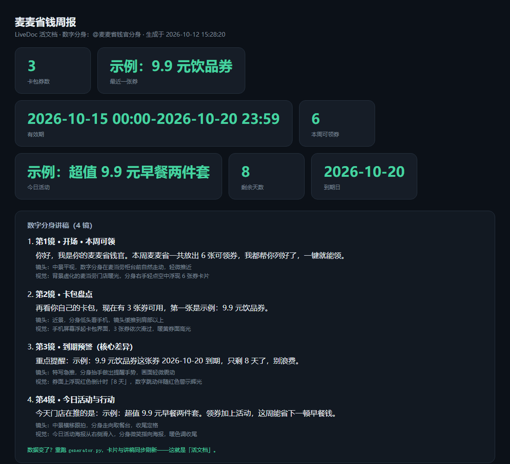

# LiveDoc · 活文档生成器

**你的汇报视频，能不能自己更新？**

<details open>
<summary><b>🌐 English</b> (click to collapse / <a href="README_EN.md">full English README</a>)</summary>

**Can your report video update itself?**

LiveDoc turns a "dead PPT" into a "living video": feed in **layout + data declaration + script**, get dynamic content with **live data + digital-avatar narration**. Data changes → re-run → auto-updated. Native **MCP** data sources, zero third-party dependencies.

See [README_EN.md](README_EN.md) for installation and usage.

</details>

🔗 **[在线演示（点开即看，无需安装）](https://hanrixing.github.io/livedoc/)** · **[提升路线图](ROADMAP.md)**

▶️ **12 秒数字分身讲解视频** —— 即梦 AI 生成，分身直接念台词。点击封面播放：

[](docs/video/mcd-weekly-demo.mp4)



把「死 PPT」变成「活视频」：输入**版式 + 数据声明 + 讲稿**，输出带**实时数据 + 数字分身讲解**的动态内容。
数据变了，重跑一次，数字和讲稿自动刷新——这就是和「PPT 转视频」工具的本质区别。

```
版式模板  ─┐
数据声明  ─┼─►  LiveDoc  ─►  活文档预览（HTML）
讲稿分镜  ─┘                + 数字分身讲稿（即梦分镜脚本）
              ▲
        MCP / HTTP 实时数据源
```

## 为什么不是又一个「PPT 转视频」

| 维度 | PPT 转视频工具（MoneyPrinterTurbo 等） | LiveDoc |
|---|---|---|
| 数据 | 截图写死在视频里，做完就过时 | **声明式数据源，实时拉取** |
| 讲解 | TTS 机器人配音，机械味 | **数字分身真人形象**（即梦 `@分身名`） |
| 产物 | 一个死 MP4 | **数据变 → 重跑 → 自动更新** |
| 数据源协议 | 基本只有静态文件 | **原生支持 MCP**（已验证接麦当劳官方 MCP） |

「活数据 + 真人分身 + 可重生成」这三块拼起来的交叉点，目前没人占。

## 快速开始

零第三方依赖，Python 标准库即可跑（建议 3.9+）：

```bash
cd livedoc
python src/generator.py                    # demo 模式：脱敏示例数据，产物可公开
python src/generator.py --live             # 真实模式：拉真数据
python src/generator.py spec/mcd-weekly.livedoc --live   # 指定规格
```

产物落在 `output/`：

| 文件 | 说明 |
|---|---|
| `output/<name>.html` | 活文档预览：数据卡片 + 来源标注 + 完整讲稿 |
| `output/<name>.jimeng.md` | 即梦数字分身分镜讲稿（每段 = 一镜，含口播/镜头/视觉） |

## 隐私设计：真实数据不会误公开

这是本项目刻意做的一层防护——因为 MCP 数据源会拉到**你的个人资产**（卡包里的券、积分余额）。

| 模式 | 数据 | 产物位置 | 能否公开 |
|---|---|---|---|
| `python generator.py` | 脱敏示例值 | `output/` | ✅ 可公开 |
| `--live`（`sensitive: true` 规格） | 你的真实个人数据 | `output/live/`（已 gitignore） | ❌ 仅本地 |
| `--live`（`sensitive: false` 规格） | 公开数据源（如 GitHub API） | `output/` | ✅ 可分享 |

`meta.sensitive` 由规格作者声明，生成器据此决定隔离与告警。默认保守值 `true`。

Token 读取优先级：环境变量 `MCD_MCP_TOKEN` → `~/.workbuddy/mcp.json`。**Token 永不进入产物文件。**

## 三个内置示例

| 规格 | 数据源 | 演示点 |
|---|---|---|
| `spec/quarterly-report.livedoc` | GitHub API（公开） | 仓库 Star/Fork/Issue 实时入稿，公开数据可直接分享 |
| `spec/mcd-weekly.livedoc` | **麦当劳官方 MCP**（`query-my-coupons` / `available-coupons` / `campaign-calendar`） | 真实券数据 + **自动算到期天数**，体现敏感数据隔离 |
| `spec/daily-weather.livedoc` | open-meteo 天气 API（公开，免 key） | 温度/湿度/降雨概率实时入稿，天气代码经**声明式映射表**自动翻译成中文——证明不只能接 MCP |

已实测：三个 MCP 工具全部返回真实数据，讲稿自动填充为「你卡包有 1 张券，9.9 美禄可可雪冰 10-12 到期，只剩 1 天」；天气播报实时拉海口数据（示例运行：晴，28.7°C）。

## 规格格式速览

一份 `.livedoc` 就是一段 JSON，四块内容：

```json
{
  "meta":    { "title": "麦麦省钱周报", "avatar": "@你的分身", "sensitive": true },
  "data_sources": [
    { "id": "my_coupons", "type": "mcp", "server": "mcd-mcp",
      "tool": "query-my-coupons", "args": {},
      "extract": { "coupon_count": "共\\s*(\\d+)\\s*张可用优惠券" },
      "fallback": { "coupon_count": 3 } }
  ],
  "compute": { "expiry_days": { "op": "days_until", "from": "coupon_expiry" } },
  "script":  [ { "shot": "到期预警", "speak": "这张券还剩 {expiry_days} 天", "camera": "...", "visual": "..." } ]
}
```

- `data_sources`：支持 `mcp` / `http` / `mock` 三种；`extract` 用正则从 MCP 返回的文本里抽字段（`op: count` 可计数）
- `compute`：派生字段，如从有效期算出还剩几天到期
- `script`：分镜讲稿，`{占位符}` 会被真实数据替换

完整格式定义见 [`livedoc_schema.md`](livedoc_schema.md)。

## 数字分身讲解层怎么接

1. 在即梦创建你的数字分身（App【出镜】→ 录 10–15 秒 → 起名）
2. 把分身名填进 `.livedoc` 的 `meta.avatar`
3. 把 `<name>.jimeng.md` 每段讲稿 + 镜头/视觉，作为即梦提示词逐镜生成
4. 出片后，这段讲解视频就绑定了 LiveDoc 的数据——**数据变，重跑即重生成**

## 当前状态与路线图

- ✅ v0.2：MCP 数据源打通、字段抽取、派生计算、双模式隐私隔离
- ⬜ 调即梦 API 自动出片（当前需手动把讲稿贴进即梦）
- ⬜ 版式模板可视化编辑器（当前 `meta.layout` 为逻辑声明）
- ⬜ 更多数据源适配器（数据库 / 飞书表格 / 企业 BI）

## License

MIT © 2026 hanrixing
